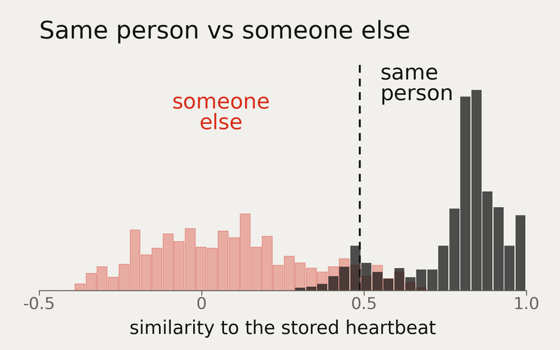
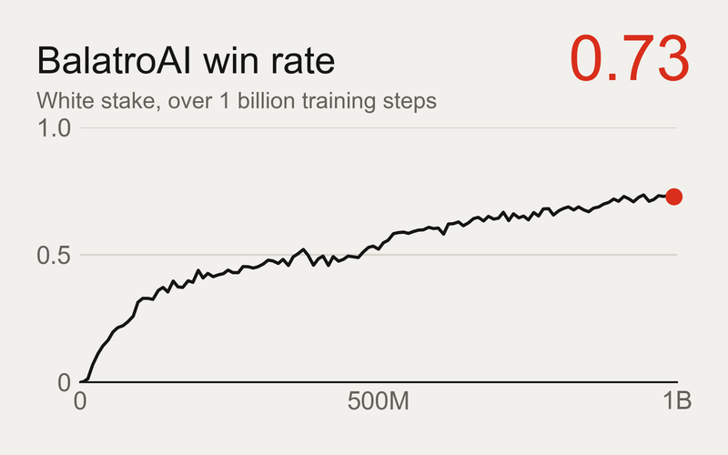
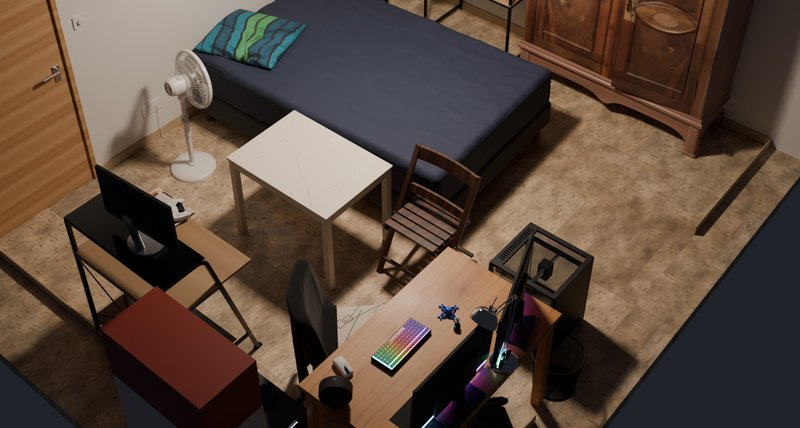
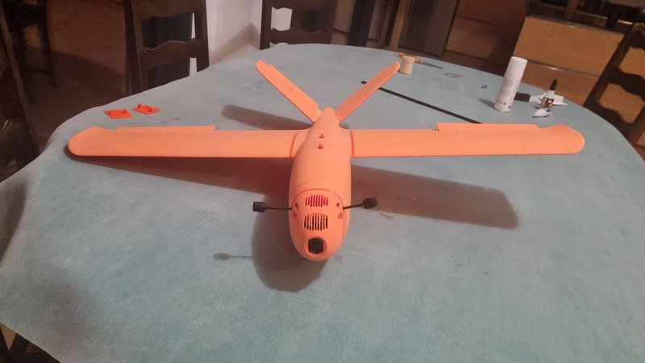

I build software and hardware. Lately: people identified from their heartbeat, engine sound worked out from gas flow, rooms rebuilt as measured 3D models, and agents that play games.

I studied computer science at RIT and left in January 2026 to build full time: my own projects, plus contract work on AI projects. From November 2026 I'm also part-time at Third Axis AI, doing agentic QA. Based in Aix-en-Provence, France. English and French, both native.

I'm looking for a full-time role or an internship, in software or hardware. France, the EU, remote or the US.

[Site](https://oliviercouthaud.com) · [CV](https://oliviercouthaud.com/cv) · [LinkedIn](https://www.linkedin.com/in/olivier-couthaud)

## Selected work

<table>
<tr>
<td width="50%" valign="top">

 <b><a href="https://oliviercouthaud.com/heartbeatid">HeartbeatID</a></b> · Prototype
 Identifies people by heartbeat: 92% top-1 across days on 10 unseen people (chance is 10%). Public ECG data, one seed, small test set. A watch app is built; no watch results yet.
</td>
<td width="50%" valign="top">

 <b><a href="https://oliviercouthaud.com/balatro">BalatroAI</a></b> · In progress
 A Rust copy of Balatro, replayed against the real game for 1,892 actions with no real mismatches. An AI trained in it wins about 2 in 3 White-stake games (66 to 73 in 100, depending on the test); on Gold, the hardest, the best from-the-start result is 2 to 5 in 100. Code not public.
</td>
</tr>
<tr>
<td width="50%" valign="top">

 <b><a href="https://oliviercouthaud.com/house23d">House23D</a></b> · In progress
 My bedroom as a Blender model, scaled from one tape-measured room size. Checked by overlaying renders on photos; the error is not measured. Joining rooms into a house failed my alignment checks.
</td>
<td width="50%" valign="top">

 <b><a href="https://oliviercouthaud.com/picotalon">PicoTalon</a></b> · In progress
 A 905 mm RC plane, 3D printed in pieces and assembled, 400 g with battery. Waiting on its electronics; it has not flown yet.
</td>
</tr>
</table>

## Also

- **[Fault-Tolerant Quadrotor](https://oliviercouthaud.com/drone)** · Prototype, simulation only · [code](https://github.com/Forkei/fault-tolerant-quadrotor). A published drone-control recipe, rebuilt. At normal speed, a figure-eight is off by about 8 cm with one propeller at 70% thrust, against about 6 cm healthy; fast runs with the fault often crash. The paper's code starts the figure-eight at T/4 and does not say so; until I matched it, my fault-trained policy looked 2.5 times worse. Nothing has flown.
- **[EngineSim](https://oliviercouthaud.com/enginesim)** · In progress. Engine sound worked out from gas flow, not recordings. Power and torque land within about 20% of published figures for three similar real engines, none tuned to them. The best of my machine judges still tells it from real recordings 91 to 100% of the time; no listening test with people yet.
- **[Gaussian splats](https://oliviercouthaud.com/splats)** · Working, one room checked. Phone video to 3D scenes you can orbit in a browser, about $0.40 a run. Changing the camera-pose method took one night scene from about 10% of photos placed to 98%.
- **[VOS](https://oliviercouthaud.com/vos)** · Prototype · [code](https://github.com/Forkei/VOS-public). A team of AI agents behind a desktop-style app, by text and phone call. Built with Roman Slack, who designed the app. I built the SDK every agent runs on, the API gateway and the primary agent; the voice gateway is shared work. No automated tests.

Most of this has no public repository, so the names link to their pages. More public code: [mtg-ai](https://github.com/Forkei/mtg-ai), [drone-rl](https://github.com/Forkei/drone-rl). [All 38 projects](https://oliviercouthaud.com/projects).
